<p align="center">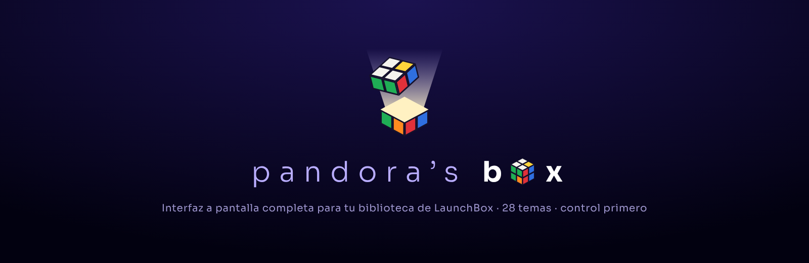</p>

**Pandora's Box** es una interfaz a pantalla completa para jugar tu colección de emulación desde el sillón con un control de Xbox. Lee tu biblioteca de **LaunchBox** (juegos, imágenes, videos, música, emuladores y núcleos) sin modificar nada: LaunchBox sigue siendo donde administras todo, y Pandora's Box es la caja que lo abre.

> *English summary below.*

<p align="center">
  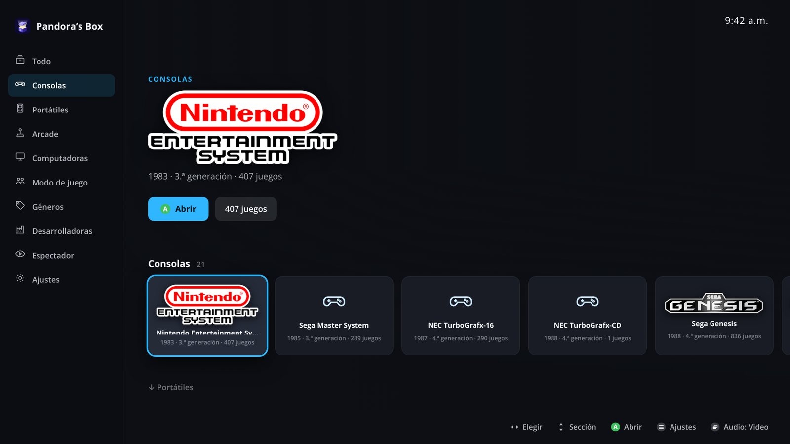
  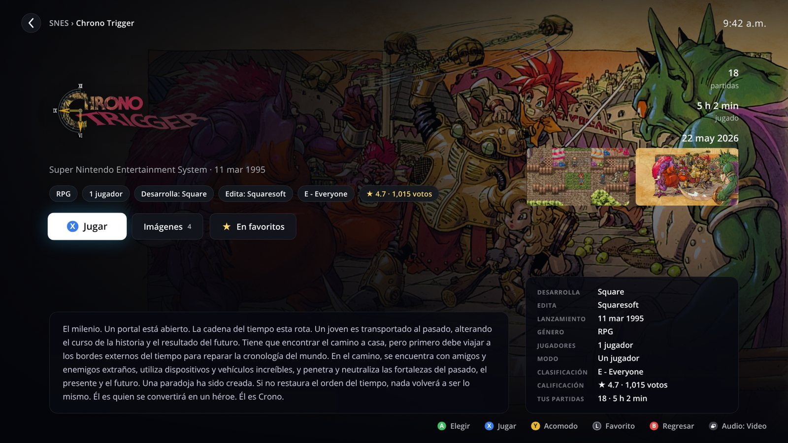
  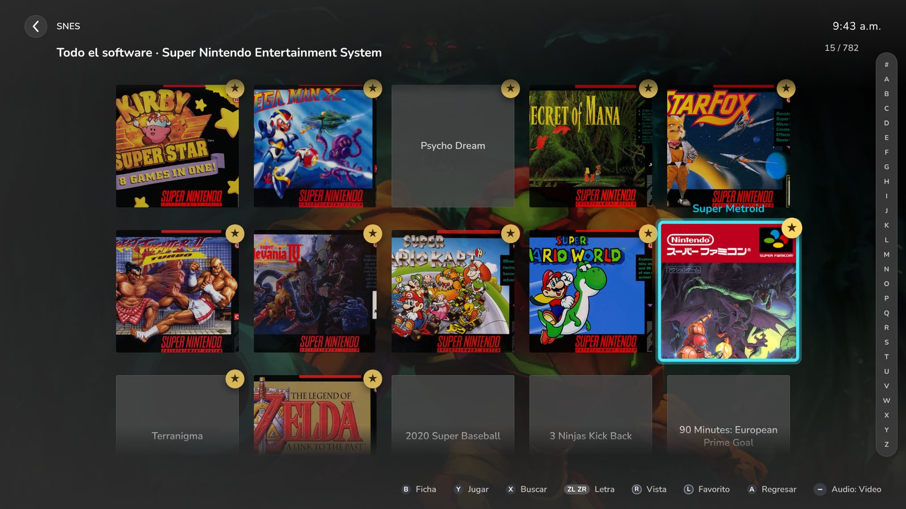
  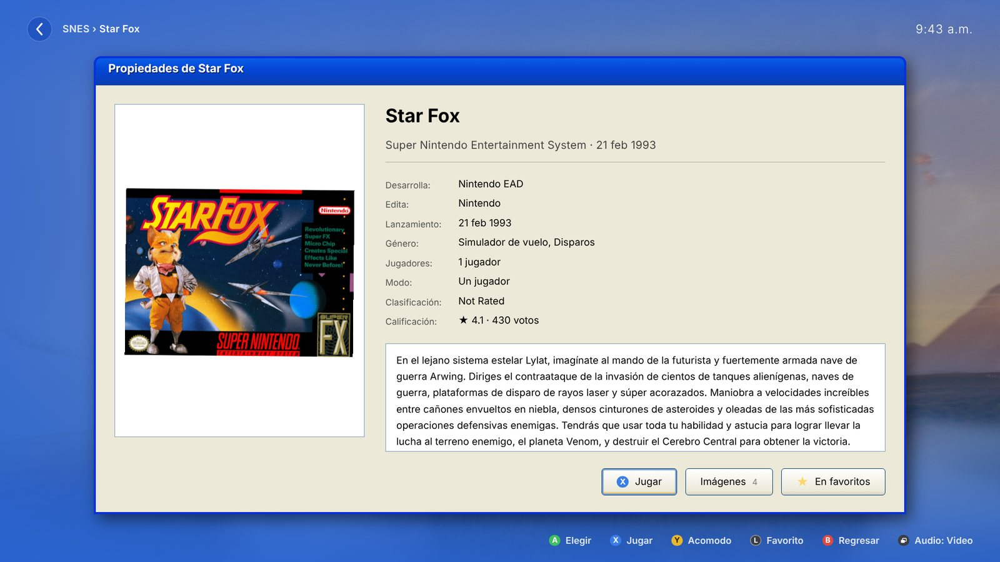
</p>

## Qué hace

- **30 temas** inspirados en el diseño de consolas y sistemas (GameCube, PS1 a PS5, Xbox a Series X, NES, Super Nintendo, N64, Wii, Wii U, Switch, Game Boy, GBA, DS, 3DS, Virtual Boy, Genesis, Saturn, Dreamcast, TurboGrafx-16, Arcade, MSX, MS-DOS, Windows XP), más tres inspirados en frontends: Playnite, Steam Big Picture y Apple TV. No usan logos ni sonidos de las marcas: todo se dibuja y se sintetiza.
- **Cada tema trae su propia lista de juegos y su propia ficha** («Del tema»): en MS-DOS la lista es un panel de archivos y la ficha un `TYPE JUEGO.TXT`; en Windows XP, una ventana del Explorador y sus Propiedades; en Game Boy, un menú con cursor ▶ y una ficha de enciclopedia…
- **Vistas que sirven en cualquier tema**: Repisa, Carrusel, Rejilla, Lista, Rueda y Biblioteca para la lista; Clásica, Cine, Póster, Galería y Héroe para la ficha.
- **Tema aleatorio** al abrir la app, eligiendo con interruptores qué temas pueden salir.
- **Pensada para control**: todo se maneja con un control de Xbox (XInput), con ayudas en pantalla en el estilo de botones que elijas (Xbox, PlayStation, Nintendo, Sega…). También funciona con teclado y ratón.
- **Abre los juegos como LaunchBox**: usa el emulador y la línea de comandos de cada plataforma (incluido el núcleo de RetroArch marcado como predeterminado), aplicaciones adicionales y accesos directos.
- **Cierra los juegos con tu mismo atajo de LaunchBox** (por ejemplo, mantener RS y presionar B), o con una combinación propia.
- Videos, música de cada juego, sonido de ambiente, **modo cine** y **modo espectador**.
- Búsqueda con teclado en pantalla, barra de letras, favoritos, partidas y tiempo jugado.
- Secciones por consolas, portátiles, arcade, computadoras, modo de juego, géneros y **desarrolladoras con su logo** (se buscan una sola vez en Wikidata/Wikipedia).
- Si no encuentra LaunchBox, una **bienvenida** te ayuda a elegir la carpeta, así que la puedes compartir con otra persona.

## Más capturas

| | |
|---|---|
| 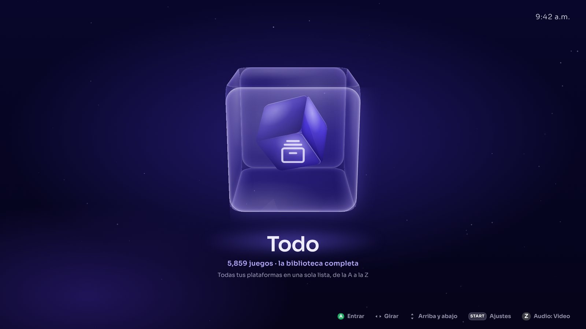 | 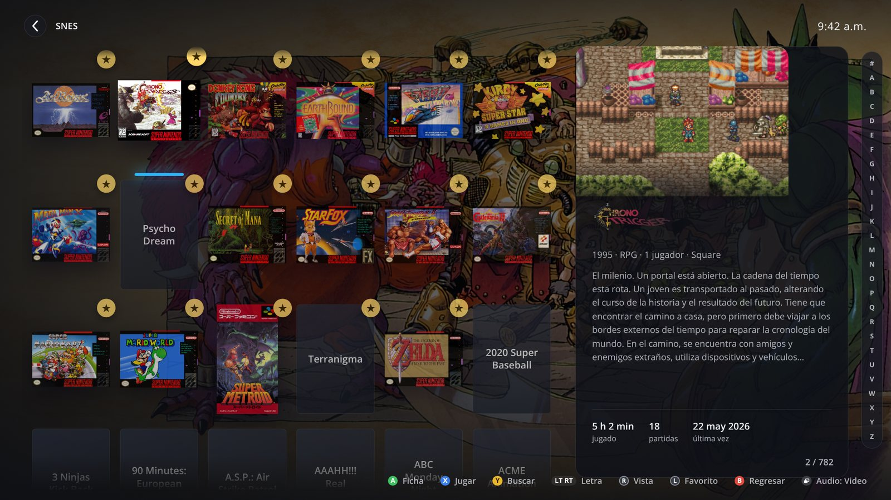 |
| 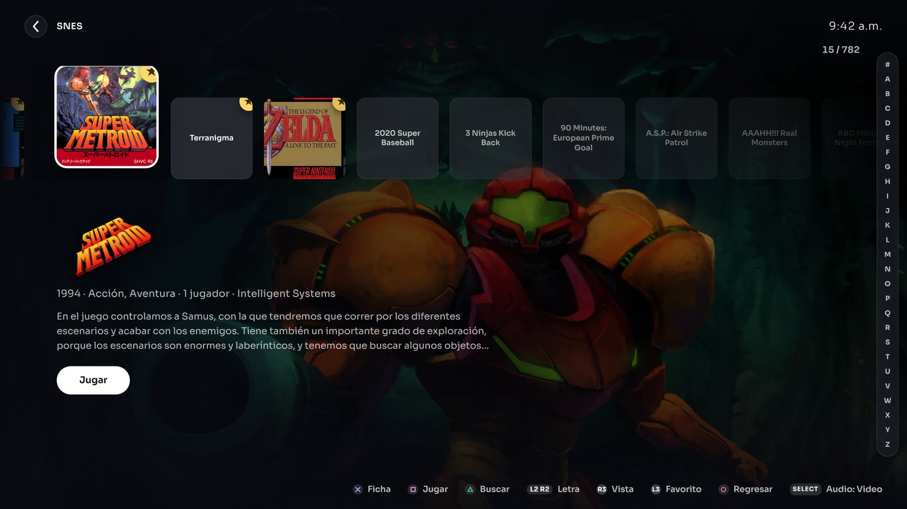 | 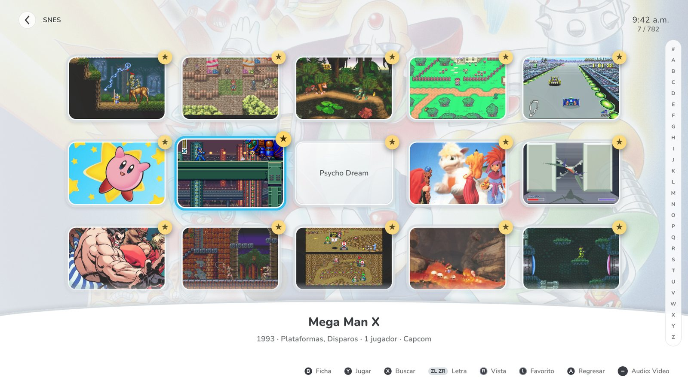 |
| 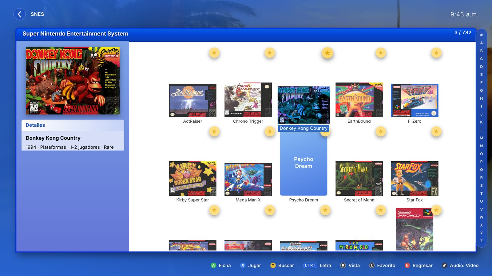 | 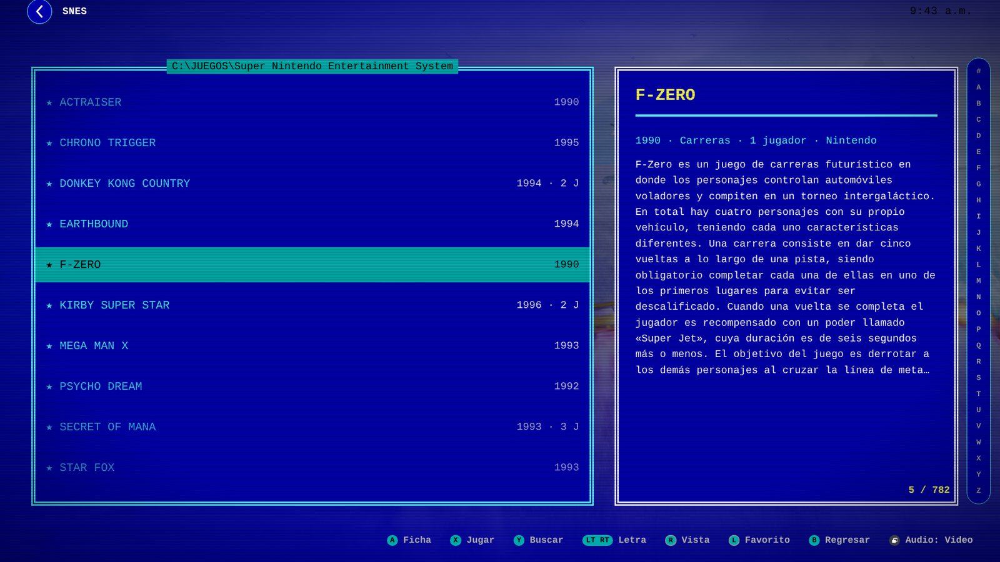 |
| 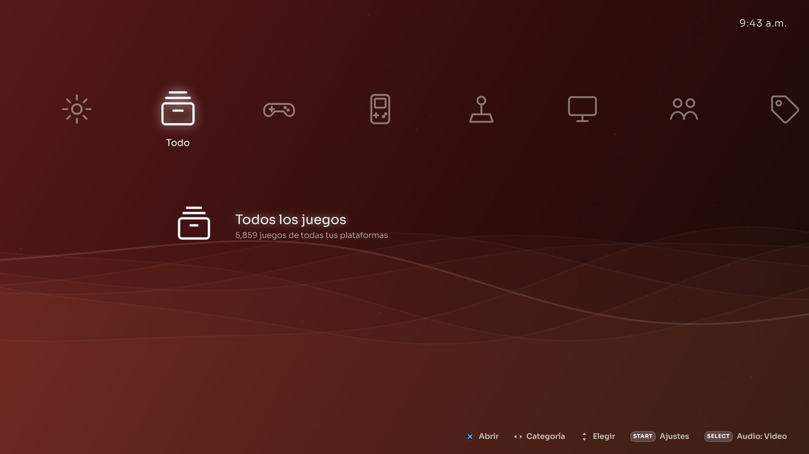 | 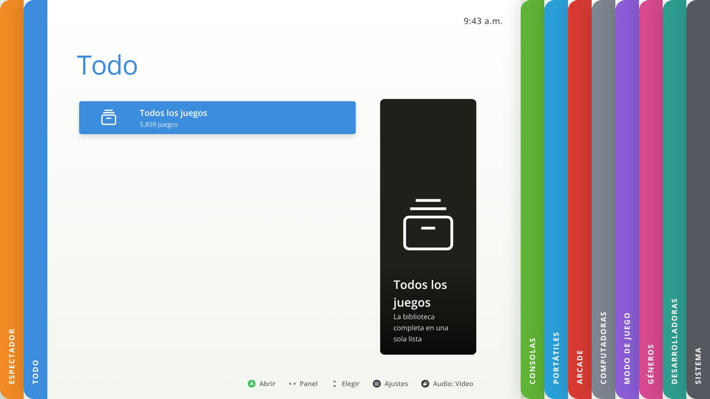 |
| 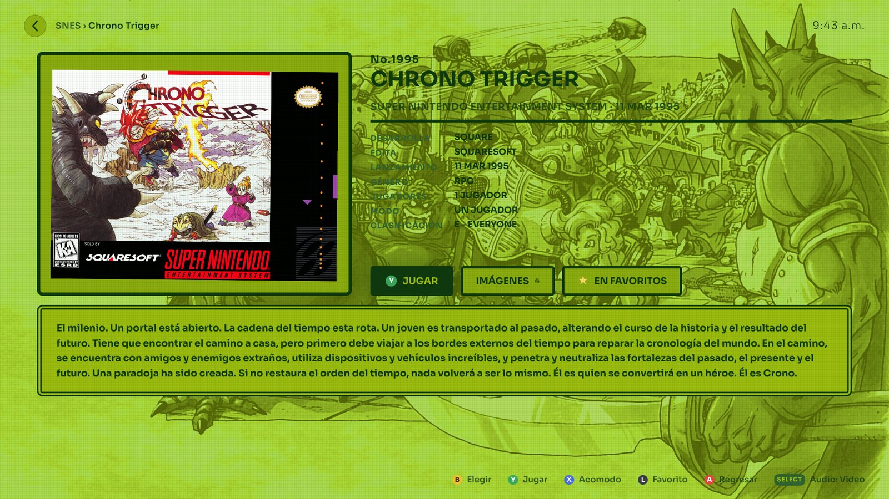 | 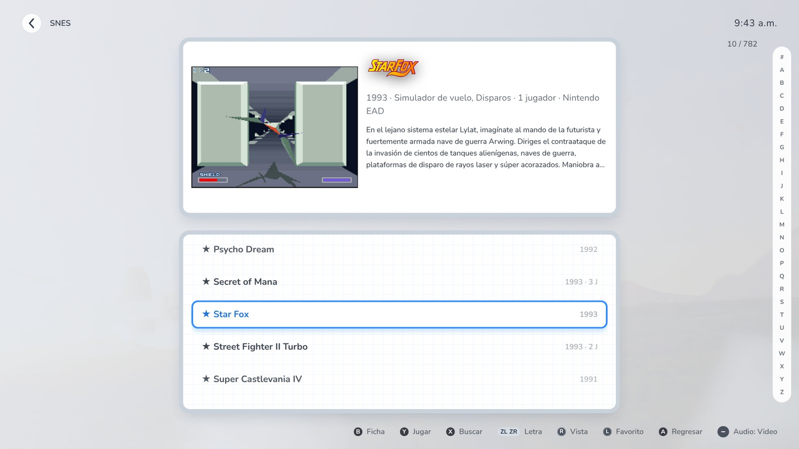 |

## Requisitos

- Windows 10 u 11.
- [LaunchBox](https://www.launchbox-app.com/) con tu biblioteca ya armada (Pandora's Box solo la lee).
- Un control compatible con XInput (Xbox o similar). Opcional: teclado y ratón.

## Instalar y ejecutar

**Desde el código:**

```bash
git clone https://github.com/<tu-usuario>/pandoras-box.git
cd pandoras-box
npm install
npm start
```

La primera vez te pedirá la carpeta de LaunchBox si no la encuentra sola. Tus ajustes, favoritos y estadísticas se guardan en la carpeta `datos/` (que no se sube al repositorio).

**Como aplicación portátil (`Pandora.exe`):** descarga [Electron](https://github.com/electron/electron/releases) para Windows x64, renombra `electron.exe` a `Pandora.exe` y copia este repositorio (con su `node_modules`) dentro de `resources/app`. Los datos quedan en `datos/`, junto al `.exe`.

## Controles

| Botón | Acción |
|---|---|
| A | Abrir / elegir |
| X | Jugar directamente |
| B | Volver |
| Y | Buscar |
| LB / RB | Saltar varios, o cambiar de pestaña |
| LT / RT | Letra anterior / siguiente |
| RS (clic) | Cambiar la vista de la lista |
| LS (clic) | Favorito |
| Vista | Audio de fondo: video, música o ambiente |
| Menú | Ajustes |

La guía completa está en [docs/GUIA.md](docs/GUIA.md).

## Cómo está hecha

- **`main.js`**: ventana de Electron a pantalla completa; se aparta cuando el juego está al frente y vuelve al cerrarlo.
- **`server.js`**: servidor local que lee los XML de LaunchBox (`Data/Platforms.xml`, `Data/Platforms/*.xml`, `Data/Emulators.xml`), indexa imágenes, videos y música, y abre los juegos.
- **`lib/launch.js`**: arma la línea de comandos como LaunchBox, lanza y vigila el proceso, lee el control (XInput vía koffi) para el atajo de cierre y deja un registro en `datos/registro.txt`.
- **`lib/logos.js`**: logos de desarrolladoras desde Wikidata (propiedad P154) y Wikipedia.
- **`public/`**: la interfaz, en JavaScript sin frameworks. `app.js` (pantallas, ajustes, listas y fichas), `sound.js` (efectos y ambiente sintetizados con Web Audio) y `themes/<tema>/` (`home.js` + `theme.css`).

### Crear un tema

Cada tema es una carpeta en `public/themes/` con:

- `home.js`, que exporta `function (api, root)` y devuelve `{ build, enter, leave, action, frame, state, restore, hints }`.
- `theme.css`, con sus colores (variables CSS) y, si quieres, su propia lista y ficha bajo `#shelf.L-tema` y `#detail.D-tema`.

Luego se registra en `THEMES` dentro de `public/app.js`.

## Aviso

Pandora's Box es un proyecto personal sin relación con LaunchBox ni con Unbroken Software, ni con Nintendo, Sony, Microsoft, Sega, NEC, Atari ni ninguna otra marca mencionada. Los temas están *inspirados* en el diseño de esas consolas y no incluyen sus logos ni sus sonidos. Los nombres y marcas pertenecen a sus dueños.

No incluye juegos, BIOS ni emuladores. Las carátulas e imágenes de las capturas vienen de la biblioteca de LaunchBox del autor y pertenecen a sus respectivos dueños.

## Licencia

[MIT](LICENSE). Componentes de terceros en [THIRD_PARTY.md](THIRD_PARTY.md).

---

## English summary

**Pandora's Box** is a controller-first, full-screen frontend for your **LaunchBox** library. It reads LaunchBox's data read-only (games, media, emulators and RetroArch cores) and launches games the same way LaunchBox does, including your LaunchBox exit-game shortcut. It ships 30 themes inspired by consoles and frontends (no trademarks or original sounds; all visuals are drawn and all sounds synthesized), each with its own game list and game detail views, plus layouts that work with any theme, a random-theme mode, video previews, a cinema mode and a spectator mode. The UI is in Spanish.

```bash
npm install
npm start
```

MIT licensed. Not affiliated with LaunchBox, Unbroken Software or any console maker.
